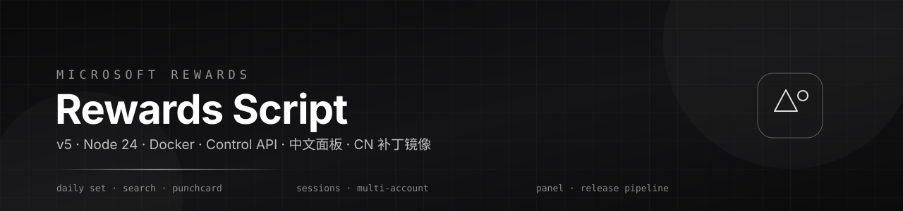
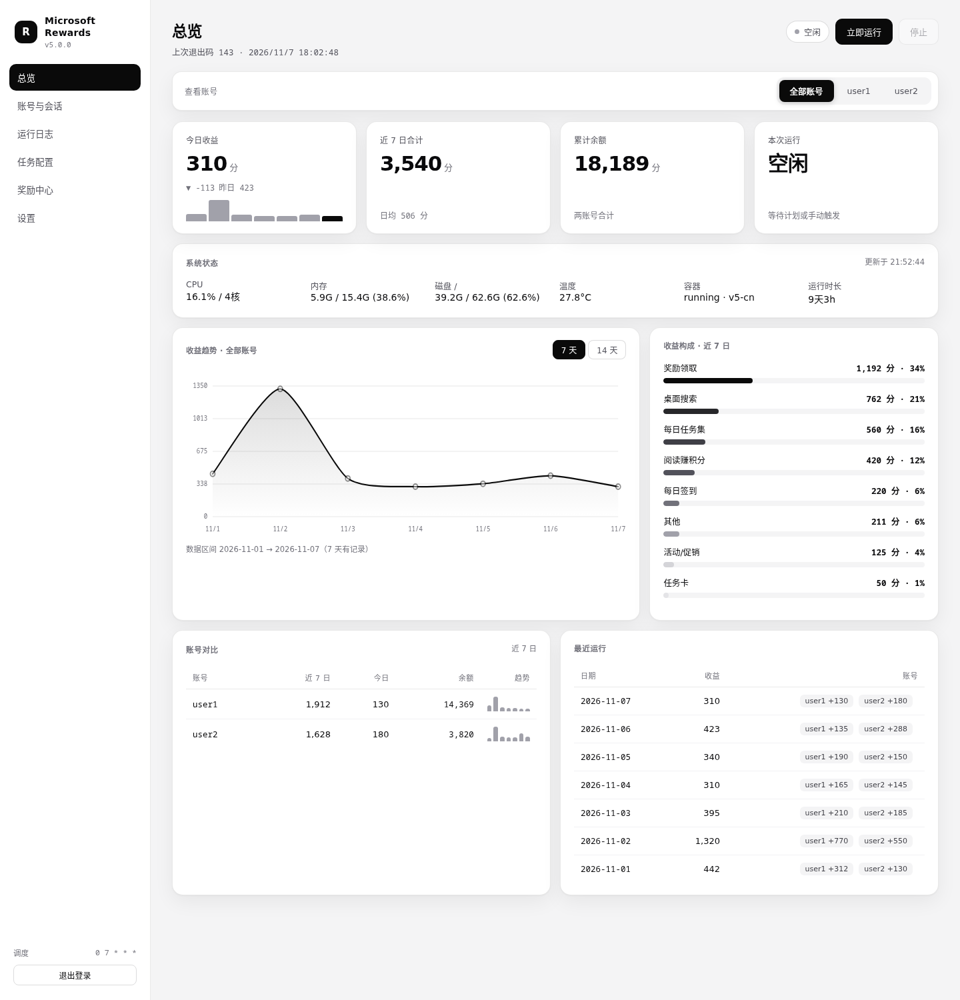
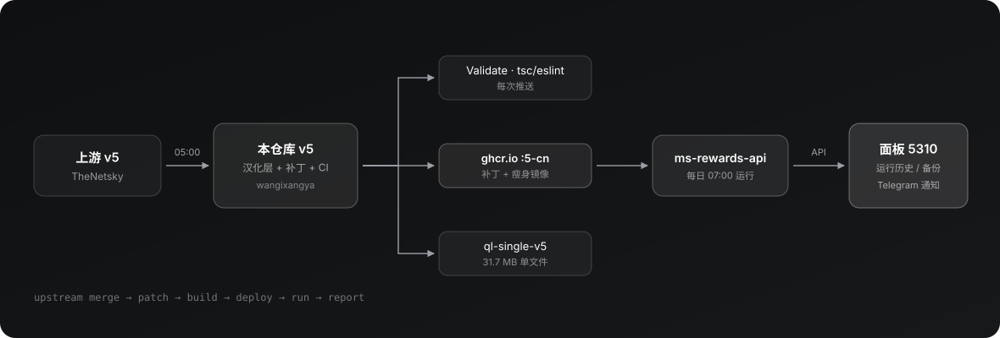

<p align="center">
  
</p>

<p align="center">
  <a href="https://github.com/wangixangya/Microsoft-Rewards-Script/actions/workflows/validate.yml"></a>
  
  <a href="https://github.com/wangixangya/Microsoft-Rewards-Script/pkgs/container/microsoft-rewards-script"></a>
  
  
  <a href="LICENSE"></a>
</p>

<p align="center">
  <b>简体中文</b> · <a href="#english">English</a> · <a href="README.zh-CN.md">完整中文说明</a> · <a href="docs/usage.md">文档</a> · <a href="docs/control-api.md">控制接口</a>
</p>

---

## 概览

**微软积分自动化脚本** —— 支持 API 与浏览器两种模式、会话复用、多账号、本地化搜索与控制接口。
本仓库是 [TheNetsky/Microsoft-Rewards-Script](https://github.com/TheNetsky/Microsoft-Rewards-Script) 上游 `v5`
的持续跟进分支：与上游保持每日同步，并额外提供中文控制台、国内网络补丁镜像与自动化发布流水线。

> **来源与致谢（二改声明）**
>
> 本仓库是**二改版本**，代码来源链条如下：
>
> 1. **原作者**：[TheNetsky/Microsoft-Rewards-Script](https://github.com/TheNetsky/Microsoft-Rewards-Script) —— 原始项目，`v5` 全部核心逻辑与架构归原作者；
> 2. **中文/国内适配**：[hex-ci/Microsoft-Rewards-Script](https://github.com/hex-ci/Microsoft-Rewards-Script) —— 本仓库在此基础上做的中文适配与国内网络处理；
> 3. **本仓库（二次改动）**：在 hex-ci 的基础上继续二改，新增中文 Web 控制台、`:5-cn` 国内补丁镜像、单文件 JS 打包与自动化发布流水线。
>
> 原项目版权归原作者所有，遵循 **GPL-3.0**；本二改部分同样以 GPL-3.0 发布，保留原作者与 hex-ci 的署名。**请优先支持原作者与 hex-ci 的上游项目。**

|              |                                                                               |
| :----------- | :---------------------------------------------------------------------------- |
| **运行环境** | Node.js ≥ 24 · patchright · Docker（amd64 / arm64）                           |
| **运行模式** | `api`（HTTP，快）· `browser`（渲染卡片，GhostCursor）· `maximize`（尽量多刷） |
| **并发**     | `clusters` 1–4 分片并行 · `accountDelay` 随机 1–3 分钟                        |
| **入口**     | 命令行 · Docker · 控制接口 · 中文 Web 面板                                    |
| **上游**     | 每日 05:00 自动合并 TheNetsky v5（经 hex-ci 中文适配）                        |

---

## 特性

<table>
<tr><td width="50%" valign="top">

**自动化**

- 每日任务、促销活动、打卡卡片、奖励领取
- 桌面 / 移动搜索、Bing Explore
- 每日签到、阅读赚分、连续天数保护
- 可选视觉搜索与后台 Edge 浏览

</td><td width="50%" valign="top">

**运维**

- 会话复用、多账号、按账号独立定时
- 控制接口：实时事件、历史记录、卡片进度
- Discord / Telegram / ntfy 推送

</td></tr>
<tr><td valign="top">

**本分支增强**

- 中文 Web 面板（总览 / 日志 / 配置 / 奖励 / 发布）
- `:5-cn` 镜像：放宽 Bing 域名判定，支持 `cn.bing.com`
- 单文件 JS 包，青龙 / 纯 Node 环境可直接跑

</td><td valign="top">

**工程化**

- `Validate`（tsc + eslint + prettier）每次推送必跑
- `patch-bing-origin.js` 源码级打补丁，少于 5 处替换直接失败
- 面板 / 单文件包按哈希判断变更，避免无意义重复发布

</td></tr>
</table>

---

## 快速开始

```bash
docker run -d --name ms-rewards \
  -e TZ=Asia/Shanghai \
  -e CONFIG_CLUSTERS=2 \
  -v "$PWD/config:/usr/src/microsoft-rewards-script/config" \
  -v "$PWD/sessions:/usr/src/microsoft-rewards-script/sessions" \
  ghcr.io/wangixangya/microsoft-rewards-script:5-cn
```

| 镜像                                                | 用途                          |
| :-------------------------------------------------- | :---------------------------- |
| `ghcr.io/thenetsky/microsoft-rewards-script:5`      | 上游官方镜像                  |
| `ghcr.io/wangixangya/microsoft-rewards-script:5`    | 本仓库镜像（与上游一致）      |
| `ghcr.io/wangixangya/microsoft-rewards-script:5-cn` | **国内补丁版 + 瘦身**（推荐） |

> **拉不下来？** ghcr 包若提示 `denied` / `403`，有两种解法：
>
> - 带凭证拉：`echo <有 read:packages 权限的 PAT> | docker login ghcr.io -u wangixangya --password-stdin`
> - **免登录离线包**：从 [Release `v5-cn-image`](https://github.com/wangixangya/Microsoft-Rewards-Script/releases/tag/v5-cn-image) 下载 `ms-rewards-v5-cn.tar.zst`，然后
>   `zstd -d ms-rewards-v5-cn.tar.zst -c | docker load`（导入后标签与学生镜像一致）

<details>
<summary><b>本地构建</b></summary>

```sh
npm ci
npm run install:browser   # Linux: npx patchright install --with-deps chromium
npm run build
cp env.example .env && cp config.example.json config.json
npm start
```

在 `.env` 里设置 `ACCOUNT_1_EMAIL` 与登录信息，每个账号加一组编号变量。
详见 [env.example](env.example) 与 [使用文档](docs/usage.md#accounts-and-sessions)。

</details>

---

## 中文面板



单文件、零依赖的控制台，手机端与桌面端同样好用。

| 页面           | 能做什么                                                       |
| :------------- | :------------------------------------------------------------- |
| **总览**       | 今日 / 近 7 日 / 余额、系统状态（CPU、内存、磁盘、温度、容器） |
| **账号与会话** | 增删账号、绑定代理、密码 / 2FA、单账号立即运行、独立定时       |
| **运行日志**   | 最近 3 天运行记录、按账号筛选、实时日志、自动刷新              |
| **任务配置**   | `config.json` 可视化编辑、`workers` 开关、并发 `clusters`      |
| **奖励中心**   | 余额、可领取、每日领取、自动领取（默认 09:10）                 |
| **设置**       | 运行计划、推送渠道、代理、镜像与版本、发布中心、备份与恢复     |

```bash
cd panel && python3 server.py     # 0.0.0.0:5310，密码见 panel.conf
```

---

## 架构



- **同步**：上游合并 → 冲突规则（面板/文档保留本地、源码取上游）→ 推送 → CI
- **补丁**：`origin === URLs.bing.origin` 改写为 `isBingHost(...)`，让 `cn.bing.com` 通过校验
- **发布**：面板文件与单文件包按哈希比对，只有真正变化才重新部署

---

## 配置

```jsonc
{
    "clusters": 2, // 并发分片数
    "headless": true,
    "accountDelay": { "min": 1, "max": 3 }, // 分片之间的随机间隔（分钟）
    "taskDelay": { "min": 3, "max": 8 }, // 任务之间的随机间隔（秒）
    "rewardsMode": "maximize", // maximize | points | api | browser
    "workers": { "doDailySet": true, "doMorePromotions": true, "doPunchCard": true },
    "searchSettings": { "useGeoLocale": false, "scrollRandomResults": true },
    "globalTimeout": "30m",
    "debugLogs": false
}
```

内存占用：空闲约 34 MiB，单账号峰值约 1.19 GiB；2 并发建议预留 ≥ 2 GB。

---

## 文档

| 文档                                       | 内容                                                       |
| :----------------------------------------- | :--------------------------------------------------------- |
| [README.zh-CN.md](README.zh-CN.md)         | 完整中文说明：v5 差异、配置项、面板、单文件、同步流程、FAQ |
| [docs/usage.md](docs/usage.md)             | 安装、账号、设置、命令、排错                               |
| [docs/control-api.md](docs/control-api.md) | 鉴权、接口、运行控制、调度、面板数据                       |
| [panel/README.md](panel/README.md)         | 面板部署与版本变更                                         |

---

## 安全与声明

`.env`、`config/`、`sessions/`、`diagnostics/` 含账号凭据与会话 Cookie，**不要提交、不要外传**。
自动化操作可能违反服务条款，请自行评估风险；建议一个账号对应一个出口 IP。

---

<h2 id="english">English</h2>

**Microsoft Rewards Script** — automation for Microsoft Rewards with API and browser modes,
saved sessions, multi-account support, localised searches and a Control API. This branch (`v5`)
is a maintained fork of [TheNetsky/Microsoft-Rewards-Script](https://github.com/TheNetsky/Microsoft-Rewards-Script),
synced with upstream daily and extended with a Chinese control panel, a CN-patched image and a
self-hosted release pipeline.

> **Credits / what this fork is.** This is a **second-order fork**:
>
> 1. **Original author** — [TheNetsky/Microsoft-Rewards-Script](https://github.com/TheNetsky/Microsoft-Rewards-Script): all core `v5` logic and architecture.
> 2. **Chinese / CN-network adaptation** — [hex-ci/Microsoft-Rewards-Script](https://github.com/hex-ci/Microsoft-Rewards-Script): the base this repo is modified from.
> 3. **This repo (second modification)** — Chinese web panel, `:5-cn` CN-patched image, single-file JS bundle and an automated release pipeline on top of the two above.
>
> All original copyright stays with the original authors. Released under **GPL-3.0**, with attribution to TheNetsky and hex-ci preserved. Please star and support the upstream projects first.

|              |                                                                           |
| :----------- | :------------------------------------------------------------------------ |
| **Runtime**  | Node.js ≥ 24 · patchright · Docker (amd64 / arm64)                        |
| **Modes**    | `api` (HTTP, fast) · `browser` (rendered cards, GhostCursor) · `maximize` |
| **Scale**    | `clusters` 1-4 parallel shards · randomised `accountDelay` 1-3 min        |
| **Surface**  | CLI · Docker · Control API · Chinese web panel                            |
| **Upstream** | TheNetsky `v5` (via hex-ci CN adaptation), merged daily at 05:00          |

### Features

- Daily Set, promotions, punchcards and bonus-point claims
- Desktop / mobile searches, Explore on Bing, Check-In, Read to Earn
- Streak progress, API-based streak protection, verified point reporting
- Per-account scheduling, saved sessions, Discord / Telegram / ntfy notifications
- Control API with live events, persistent history and punchcard progress

**Fork additions** — Chinese panel (overview, logs, config, rewards, release), `:5-cn` image with the
Bing origin check widened for `cn.bing.com`, and a single-file JS bundle for QingLong or Node-only hosts.

### Quick start

```bash
docker run -d --name ms-rewards \
  -e TZ=Asia/Shanghai \
  -e CONFIG_CLUSTERS=2 \
  -v "$PWD/config:/usr/src/microsoft-rewards-script/config" \
  -v "$PWD/sessions:/usr/src/microsoft-rewards-script/sessions" \
  ghcr.io/wangixangya/microsoft-rewards-script:5-cn
```

| Image                                               | Purpose                           |
| :-------------------------------------------------- | :-------------------------------- |
| `ghcr.io/thenetsky/microsoft-rewards-script:5`      | Upstream build                    |
| `ghcr.io/wangixangya/microsoft-rewards-script:5`    | This fork, mirrored               |
| `ghcr.io/wangixangya/microsoft-rewards-script:5-cn` | **CN patch + slim** (recommended) |

> **Cannot pull?** If ghcr returns `denied` / `403`: either log in with a PAT that has `read:packages`
> (`echo <PAT> | docker login ghcr.io -u wangixangya --password-stdin`), or use the **no-login offline archive**
> from [Release `v5-cn-image`](https://github.com/wangixangya/Microsoft-Rewards-Script/releases/tag/v5-cn-image):
> `zstd -d ms-rewards-v5-cn.tar.zst -c | docker load`.

### Panel

A single-file, dependency-free control panel for the running container, built for phones as much
as desktops: overview with system metrics, accounts and sessions, last-3-days run history with
per-account filtering, live logs, visual config editing, rewards centre, scheduling, proxies,
image/release management and config backup.

```bash
cd panel && python3 server.py     # 0.0.0.0:5310, password in panel.conf
```

### Documentation

- [docs/usage.md](docs/usage.md) — install, accounts, settings, commands, troubleshooting
- [docs/control-api.md](docs/control-api.md) — authentication, endpoints, run control, scheduling
- [README.zh-CN.md](README.zh-CN.md) — full Chinese documentation

### Security & disclaimer

Keep `.env`, `config/`, `sessions/` and `diagnostics/` private — they contain credentials and
session cookies. Automation of reward programs may violate the provider's terms of service;
use at your own risk, one account per egress IP is strongly advised.

---

<p align="center">
  <sub>Fork of <a href="https://github.com/TheNetsky/Microsoft-Rewards-Script">TheNetsky/Microsoft-Rewards-Script</a> · GPL-3.0-or-later</sub><br>
  <sub>中文面板 · CN 镜像 · 发布流水线 —— maintained by <a href="https://github.com/wangixangya">wangixangya</a></sub>
</p>
