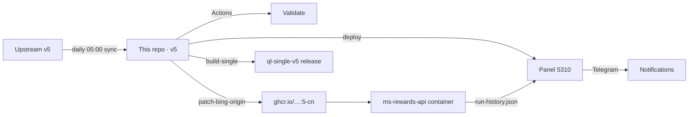

<p align="center">
  
</p>

<p align="center">
  <a href="https://github.com/wangixangya/Microsoft-Rewards-Script/actions/workflows/validate.yml"></a>
  <a href="https://github.com/wangixangya/Microsoft-Rewards-Script/pkgs/container/microsoft-rewards-script"></a>
  
  
  <a href="LICENSE"></a>
</p>

<p align="center">
  <b>English</b> · <a href="README.zh-CN.md">简体中文</a> · <a href="docs/usage.md">Docs</a> · <a href="docs/control-api.md">Control API</a>
</p>

---

## Overview · 概览

**Automation for Microsoft Rewards** — API and browser modes, saved sessions, multi-account,
localised searches and a Control API. This branch (`v5`) is a maintained fork of
[TheNetsky/Microsoft-Rewards-Script](https://github.com/TheNetsky/Microsoft-Rewards-Script),
kept in sync with upstream and extended with a Chinese panel, a CN-patched image and a
self-hosted release pipeline.

**微软积分自动化脚本** —— 支持 API 与浏览器两种模式、会话复用、多账号、本地化搜索与控制接口。
本仓库是上游 v5 的持续跟进分支，在保持与上游同步的前提下，额外提供中文控制台、国内网络补丁镜像
与自动化发布流水线。

|              |                                                                           |
| ------------ | ------------------------------------------------------------------------- |
| **Runtime**  | Node.js ≥ 24 · patchright · Docker (amd64/arm64)                          |
| **Modes**    | `api` (HTTP, fast) · `browser` (rendered cards, GhostCursor) · `maximize` |
| **Scale**    | `clusters` 1–4 parallel shards · randomised `accountDelay` 1–3 min        |
| **Surface**  | CLI · Docker · Control API · 中文 Web 面板                                |
| **Upstream** | `v5` branch of TheNetsky/Microsoft-Rewards-Script, synced daily           |

---

## Features · 特性

<table>
<tr><td width="50%" valign="top">

**Automation**

- Daily Set, promotions, punchcards, bonus claims
- Desktop / mobile search, Explore on Bing
- Check-in, Read to Earn, streak protection
- Visual Search and background Edge browsing (optional)

</td><td width="50%" valign="top">

**自动化**

- 每日任务、促销活动、打卡卡片、奖励领取
- 桌面 / 移动搜索、Bing Explore
- 每日签到、阅读赚分、连续天数保护
- 可选视觉搜索与后台 Edge 浏览

</td></tr>
<tr><td valign="top">

**Operations**

- Saved sessions, multi-account, per-account scheduling
- Control API with live events and persistent history
- Discord / Telegram / ntfy notifications

</td><td valign="top">

**运维**

- 会话复用、多账号、按账号独立定时
- 控制接口：实时事件、历史记录、卡片进度
- Discord / Telegram / ntfy 推送

</td></tr>
<tr><td valign="top">

**This fork**

- 中文 Web 面板（总览 / 日志 / 配置 / 奖励 / 发布）
- `:5-cn` image — Bing origin check widened for `cn.bing.com`
- Single-file JS bundle for QingLong / Node-only hosts

</td><td valign="top">

**本分支增强**

- 中文 Web 面板（总览 / 日志 / 配置 / 奖励 / 发布）
- `:5-cn` 镜像：放宽 Bing 域名判定，支持 `cn.bing.com`
- 单文件 JS 包，青龙 / 纯 Node 环境可直接跑

</td></tr>
</table>

---

## Quick start · 快速开始

```bash
docker run -d --name ms-rewards \
  -e TZ=Asia/Shanghai \
  -e CONFIG_CLUSTERS=2 \
  -v "$PWD/config:/usr/src/microsoft-rewards-script/config" \
  -v "$PWD/sessions:/usr/src/microsoft-rewards-script/sessions" \
  ghcr.io/wangixangya/microsoft-rewards-script:5-cn
```

| Image                                               | Purpose · 用途                           |
| :-------------------------------------------------- | :--------------------------------------- |
| `ghcr.io/thenetsky/microsoft-rewards-script:5`      | Upstream build · 上游官方镜像            |
| `ghcr.io/wangixangya/microsoft-rewards-script:5`    | This fork, mirrored · 本仓库镜像         |
| `ghcr.io/wangixangya/microsoft-rewards-script:5-cn` | **CN patch + slim · 国内补丁版**（推荐） |

<details>
<summary><b>Local build · 本地构建</b></summary>

```sh
npm ci
npm run install:browser   # Linux: npx patchright install --with-deps chromium
npm run build
cp env.example .env && cp config.example.json config.json
npm start
```

Set `ACCOUNT_1_EMAIL` and the sign-in settings in `.env`; add one numbered block per account.
See [env.example](env.example) and [Setup and usage](docs/usage.md#accounts-and-sessions).

</details>

---

## Panel · 中文面板


A single-file, dependency-free control panel for the running container — built for phones as
much as desktops. · 单文件、零依赖的中文控制台，手机端同样可用。

| Page · 页面           | What you get · 能做什么                                        |
| :-------------------- | :------------------------------------------------------------- |
| 总览 · Overview       | 今日 / 近 7 日 / 余额、系统状态（CPU、内存、磁盘、温度、容器） |
| 账号与会话 · Accounts | 增删账号、绑定代理、密码 / 2FA、单账号立即运行、独立定时       |
| 运行日志 · Logs       | 最近 3 天运行记录、按账号筛选、实时日志、自动刷新              |
| 任务配置 · Config     | `config.json` 可视化编辑、`workers` 开关、并发 `clusters`      |
| 奖励中心 · Rewards    | 余额、可领取、每日领取、自动领取（默认 09:10）                 |
| 设置 · Settings       | 运行计划、推送渠道、代理、镜像与版本、发布中心、备份与恢复     |

```bash
cd panel && python3 server.py     # 0.0.0.0:5310, password in panel.conf
```

---

## Architecture · 架构



- **Sync** — upstream merge → conflict rules (panel/docs win, source wins) → push → CI.
- **Patch** — `.github/scripts/patch-bing-origin.js` rewrites `origin === URLs.bing.origin`
  comparisons into `isBingHost(...)`, so `cn.bing.com` passes; build fails if fewer than 5
  replacements, preventing silent breakage on upstream refactors.
- **Publish** — panel files and the single-file bundle are only re-deployed when their hash changes.

---

## Configuration · 配置

```jsonc
{
    "clusters": 2, // parallel shards · 并发分片
    "headless": true,
    "accountDelay": { "min": 1, "max": 3 }, // minutes between shards · 分片间隔
    "taskDelay": { "min": 3, "max": 8 }, // seconds between tasks · 任务间隔
    "rewardsMode": "maximize", // maximize | points | api | browser
    "workers": { "doDailySet": true, "doMorePromotions": true, "doPunchCard": true },
    "searchSettings": { "useGeoLocale": false, "scrollRandomResults": true },
    "globalTimeout": "30m",
    "debugLogs": false
}
```

Memory profile · 内存占用：idle ≈ 34 MiB，single account peak ≈ 1.19 GiB；
2 clusters 建议预留 ≥ 2 GB。

---

## Documentation · 文档

| Document                                   | Content · 内容                                             |
| :----------------------------------------- | :--------------------------------------------------------- |
| [README.zh-CN.md](README.zh-CN.md)         | 完整中文说明：v5 差异、配置项、面板、单文件、同步流程、FAQ |
| [docs/usage.md](docs/usage.md)             | 安装、账号、设置、命令、排错                               |
| [docs/control-api.md](docs/control-api.md) | 鉴权、接口、运行控制、调度、面板数据                       |
| [panel/README.md](panel/README.md)         | 面板部署与版本变更                                         |

---

## Security & disclaimer · 安全与声明

Keep `.env`, `config/`, `sessions/` and `diagnostics/` private — they contain credentials and
session cookies. Automation of reward programs may violate the terms of service of the
respective provider; use at your own risk, one account per egress IP is strongly advised.

`.env`、`config/`、`sessions/`、`diagnostics/` 含账号凭据与会话 Cookie，**不要提交、不要外传**。
自动化操作可能违反服务条款，请自行评估风险；建议一个账号对应一个出口 IP。

---

<p align="center">
  <sub>Fork of <a href="https://github.com/TheNetsky/Microsoft-Rewards-Script">TheNetsky/Microsoft-Rewards-Script</a> · GPL-3.0-or-later</sub><br>
  <sub>中文面板 · CN 镜像 · 发布流水线 —— maintained by <a href="https://github.com/wangixangya">wangixangya</a></sub>
</p>
